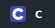
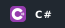
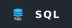
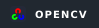
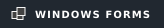

# Hi, I'm Thomas Feng

I'm a full-stack developer building web applications, interactive graphics, small games, and creative tools. I work across user interfaces and backend functionality to turn ideas into practical, usable software.

My work spans React and TypeScript web apps, C# desktop interfaces, and graphics experiments with C++ and Python.

## My Toolbox

### Languages

       

### Frameworks / Libraries

      

### Tools

    

## Open to work

I'm seeking opportunities in **software development**, **software testing / QA**, or **IT**. I'm keen to contribute to a team, keep learning, and help build and support reliable software.

---

[Explore all my repositories →](https://github.com/Thomas1255?tab=repositories)
